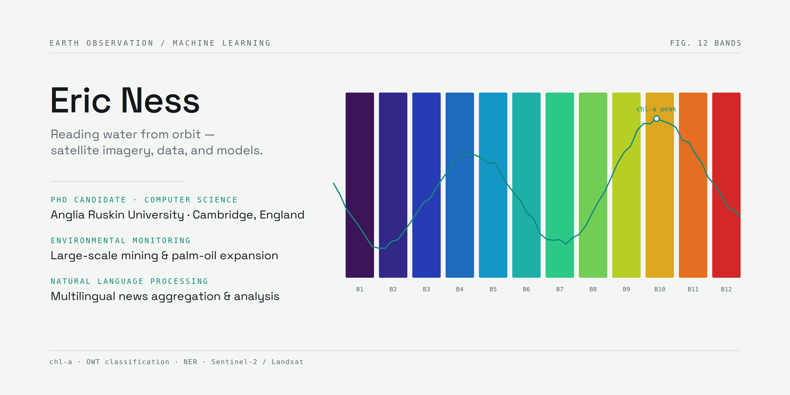

### Hi there 👋

I'm Eric Ness.

I build software for working with environmental data, and I’m currently a PhD candidate in Computer Science at Anglia Ruskin University.

A lot of my research is around using satellite imagery, machine learning, and large environmental datasets to better understand water quality.

Things I’m usually working on or thinking about:

* 🛰️ Remote sensing
* 🌊 Environmental and water quality data
* 📊 Open public data
* 🤖 Machine learning and AI
* 🗺️ Geospatial software
* 🐧 Linux distros
* 📰 News analysis applications
* 🍿 Popcorn

### Data and APIs

A family of sites that take public datasets, clean them up, and serve them as downloads and APIs. Each number keeps a link back to where it came from.

| Site | What's in it |
| --- | --- |
| [airdata.dev](https://airdata.dev) | Daily Air Quality Index for every US county, 1980 to yesterday |
| [carbondata.dev](https://carbondata.dev) | Versioned Scope 1, 2 and 3 emission factors for carbon accounting |
| [climatedata.dev](https://climatedata.dev) | Monthly temperature and precipitation for every US county since 1895, plus global records |
| [economicdata.dev](https://economicdata.dev) | US state, county and metro unemployment, jobs and income, and GDP, inflation and population by country |
| [electiondata.dev](https://electiondata.dev) | Every US Senate election since 1976, one row per candidate |
| [satellitedata.dev](https://satellitedata.dev) | A catalog of every object in orbit since Sputnik, with a log of every launch |
| [waterdata.dev](https://waterdata.dev) | Daily streamflow at every active USGS stream gage, and drought by county |
| [wildfiredata.dev](https://wildfiredata.dev) | Satellite fire detections matched to official incidents and perimeters, updated every 3 hours |
| [visualizedata.dev](https://visualizedata.dev) · [visualizedata.org](https://visualizedata.org) | Charts, maps and embeddable visualizations built on the sites above |

### Remote sensing

* [satellitedata.net](https://satellitedata.net) searches Sentinel-2 and Landsat scenes, shows them as map tiles, and exports GeoTIFFs on demand.
* [remotesensing.app](https://remotesensing.app) is a web app for remote sensing work.

### Linux distros

* [linuxlive.com](https://linuxlive.com) builds your own Linux. Pick a desktop, apps and a look, and it hands you an ISO for a USB stick.
* [numberstations.com](https://numberstations.com) is Ubuntu 26.04 LTS set up for amateur radio, with Gqrx, WSJT-X, fldigi and JS8Call ready for an RTL-SDR.
* [tikihead.org](https://tikihead.org) is Ubuntu 26.04 LTS set up for mapping, with QGIS, GRASS, GDAL and PostGIS installed.

### Other projects

* [newsanalysis.com](https://newsanalysis.com) pulls in live news from around the world and adds AI summaries, sentiment, political bias, and the people and places mentioned.
* [talkingpoints.net](https://talkingpoints.net) collects debate notes on political topics.
* [scipioniccircle.org](https://scipioniccircle.org) is a handbook with four models for building deliberate relationships.

More about me at [eric.ness.net](https://eric.ness.net).
